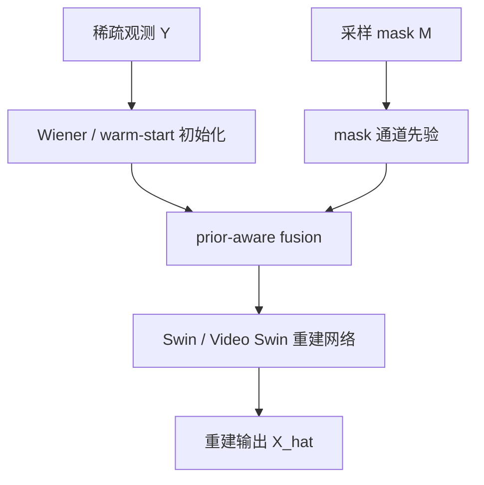

# Mask + Wiener 先验融合稀疏重建主线

本文档是当前阶段的短版研究主线。旧的 2D / 2.5D / 3D 分层仍然保留，但不再只是比较模型维度，而是服务于一个更明确的创新问题：

> 在稀疏显微采样中，Wiener 初始化提供物理逆问题初值，mask 通道提供采样置信度先验；网络应通过轻量 prior-aware fusion 显式利用二者，而不是只做普通通道拼接。

详细实验协议见 `docs/PRIOR_FUSION_EXPERIMENT_PROTOCOL.md`。

---

## 1. 核心创新链路



当前第一阶段只做低风险版本：

- `concat`：普通通道拼接，作为 baseline。
- `gated`：用 mask 分支生成门控，对 Wiener/warm-start 图像通道进行早期调制。

暂不把 cross-attention 作为第一阶段主实验，因为它会显著增加训练变量和解释成本。

---

## 2. 三类主实验

| 场景 | 数据 | 稀疏模式 | 模型输出 | 主问题 |
|---|---|---|---|---|
| 2D | MDC25-2D；CIDC25/MDC25-3D 单切面 | `x` / `y` / `xy` | 2D 图像 | 单轴/双轴空间稀疏下，mask + Wiener 是否改善结构恢复 |
| 2.5D | CIDC25-3D；MDC25-3D | `z` | 中心切面 | 轴向稀疏下，邻切面上下文与采样先验是否改善中心帧 |
| 3D | CIDC25-3D；MDC25-3D | `xyz` | 3D 体块 | 联合空间/轴向稀疏下，先验融合是否提升体重建 |

边界：

- 2D 数据只允许 `x/y/xy` 作为主实验。
- `z/xyz` 只对 3D stack 有严格物理意义。
- 2.5D 输出是中心切面，不写成 3D 体重建。
- pollen 当前仍是 2D 外部 transfer probe，不进入主 benchmark 排名。

---

## 3. 输入先验消融

| 编号 | 初始化 | mask 通道 | fusion | 用途 |
|---|---|---|---|---|
| A0 | bilinear | 无 | none | 基础输入重建能力 |
| A1 | bilinear | 有 | none | 单独验证 mask 先验 |
| A2 | Wiener | 无 | none | 单独验证物理初始化 |
| A3 | Wiener | 有 | none | 验证 mask + Wiener 组合 |
| A4 | Wiener | 有 | gated | 验证结构化先验融合 |

命令清单可由以下脚本生成：

```bash
python scripts/generate_prior_fusion_experiments.py --only all
```

---

## 4. 指标协议

全图 PSNR/SSIM 不足以解释细胞图像重建，因为背景占比大，会掩盖结构区域变化。当前指标应分四层：

| 层级 | 指标 | 解释 |
|---|---|---|
| Global fidelity | PSNR、SSIM、MS-SSIM、MAE、sSNR、FwPSNR | 全图保真和论文可比性 |
| Foreground structure | PSNR_fg、SSIM_fg、MS-SSIM_fg、NCC_fg | 细胞/结构区域恢复 |
| Background stability | bg_mean、bg_std、bg_residual_std、bg_false_positive_rate | 背景噪声和假阳性 |
| Local profile | FWHM、profile RMSE、profile correlation、peak shift | 局部分辨率与结构宽度 |

FWHM 只在局部有效 profile 上解释，不做全图平均的唯一结论依据。

---

## 5. 预处理消融

当前必须单独说明预处理是否带来收益：

- 归一化：`minmax` / `fixed` / `zscore`。
- 初始化：bilinear vs Wiener。
- mask：with mask channel vs no mask channel。
- PSF：no PSF / PSF channel / PSF loss / Wiener。
- 噪声：real low-high vs synthetic Poisson + readout。

解释原则：

- 若全局指标提升但 foreground/profile 不提升，可能是背景主导的伪提升。
- 若 foreground/profile 提升但全局 PSNR 变化小，仍可作为细胞结构恢复收益。
- Wiener + mask + gated fusion 的核心证据应来自 `A3 -> A4` 的增益，而不是只和最弱 baseline 比较。

---

## 6. 配套索引

- 数据边界：`docs/DATASET_PROTOCOL.md`
- 新主线协议：`docs/PRIOR_FUSION_EXPERIMENT_PROTOCOL.md`
- 结果分层：`docs/RESULT_TAXONOMY.md`
- 实验命令生成：`scripts/generate_prior_fusion_experiments.py`
- 主评估指标实现：`eval.py`
- prior fusion 模块：`models/prior_fusion.py`